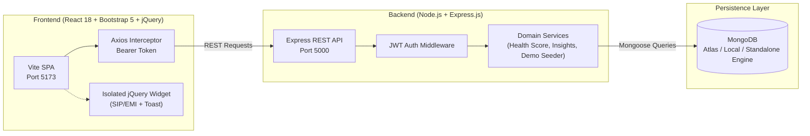

# FinTrack — Smart Expense & Budget Manager

[](#technology-stack)
[](https://nodejs.org)
[](https://mongodb.com)
[](docs/RUBRIC_CHECKLIST.md)

FinTrack is an enterprise-grade full-stack personal finance and wealth management platform designed to satisfy every dimension of an academic assessment rubric covering **Front-end Design**, **Back-end Integration**, **Functionality**, **Presentation**, **Innovation**, and **Documentation**.

---

## Table of Contents
1. [Project Overview & Objectives](#1-project-overview--objectives)
2. [Technology Stack & Justification](#2-technology-stack--justification)
3. [System Architecture](#3-system-architecture)
4. [Project Folder Structure](#4-project-folder-structure)
5. [Database Schema & Models](#5-database-schema--models)
6. [REST API Documentation](#6-rest-api-documentation)
7. [Innovation Features](#7-innovation-features)
8. [Installation & Setup Guide](#8-installation--setup-guide)
9. [Running the Application](#9-running-the-application)
10. [Automated Testing](#10-automated-testing)
11. [Academic Documentation & Presentation Resources](#11-academic-documentation--presentation-resources)
12. [Limitations & Future Enhancements](#12-limitations--future-enhancements)

---

## 1. Project Overview & Objectives

Managing personal finances requires more than simple note-taking—it requires active feedback loops. **FinTrack** helps users:
- Record, categorize, and inspect income and expenditure.
- Prevent overspending through proactive **80% caution** and **100% exceeded** budget alerts.
- Monitor long-term savings goals with realistic completion trajectories.
- Understand cashflow patterns via dynamic **Chart.js** visualizations.
- Evaluate overall financial well-being with a transparent, explainable **0–100 Financial Health Score**.
- Explore the platform instantly with a **1-Click Evaluator Demo Mode** without manual data entry.

---

## 2. Technology Stack & Justification

| Technology | Purpose in FinTrack |
| :--- | :--- |
| **HTML5** | Semantic structure (`<header>`, `<nav>`, `<main>`, `<aside>`, `<footer>`) for accessibility. |
| **CSS3** | Emerald green (`#10b981`) and navy SaaS styling, custom variables, `@keyframes fadeInUp` animations, and dark mode. |
| **Bootstrap 5** | Responsive 12-column mobile-first grid, navigation offcanvas, modal dialogs, and badges. |
| **JavaScript (ES6+)** | Currency formatting (`Intl.NumberFormat`), savings rate arithmetic with `Number.EPSILON` rounding. |
| **ReactJS (v18)** | Declarative component hierarchy, React Router v6 protected routes, and Context API state management. |
| **jQuery (v3.7)** | **Isolated demonstrator** (`JQuerySmartCalculator.jsx`): smooth `slideToggle()`, SIP/EMI sliders, and animated DOM toast alerts. |
| **Node.js & Express.js** | Modular REST API runtime with controllers, middleware, and route protection. |
| **MongoDB & Mongoose** | Persistent document storage, compound uniqueness indexes, and aggregation pipelines. |
| **JWT & Bcrypt** | Cryptographic session tokens (7-day validity) and salted password hashing (10 salt rounds). |

---

## 3. System Architecture



---

## 4. Project Folder Structure

```text
fintrack/
├── client/
│   ├── public/
│   ├── src/
│   │   ├── assets/
│   │   ├── components/
│   │   │   ├── Navbar.jsx
│   │   │   ├── Sidebar.jsx
│   │   │   ├── Footer.jsx
│   │   │   ├── QuickAddModal.jsx
│   │   │   ├── JQuerySmartCalculator.jsx    <-- Isolated jQuery DOM feature
│   │   │   ├── FinancialHealthScore.jsx     <-- Innovation: Health score widget
│   │   │   ├── SpendingAlerts.jsx           <-- Innovation: 80% & 100% threshold alerts
│   │   │   ├── SpendingComparison.jsx       <-- Innovation: Month-over-month shifts
│   │   │   ├── PersonalizedTips.jsx         <-- Innovation: Rule-based tips
│   │   │   └── DemoModeBanner.jsx           <-- Innovation: 1-click evaluator demo
│   │   ├── pages/
│   │   │   ├── LandingPage.jsx
│   │   │   ├── LoginPage.jsx
│   │   │   ├── RegisterPage.jsx
│   │   │   ├── DashboardPage.jsx
│   │   │   ├── TransactionsPage.jsx
│   │   │   ├── BudgetsPage.jsx
│   │   │   ├── SavingsGoalsPage.jsx
│   │   │   ├── ReportsPage.jsx
│   │   │   ├── SettingsPage.jsx
│   │   │   └── NotFoundPage.jsx
│   │   ├── layouts/
│   │   │   ├── MainLayout.jsx
│   │   │   └── AuthLayout.jsx
│   │   ├── context/
│   │   │   ├── AuthContext.jsx
│   │   │   └── ThemeContext.jsx
│   │   ├── services/
│   │   │   ├── api.js
│   │   │   ├── authService.js
│   │   │   ├── transactionService.js
│   │   │   ├── budgetService.js
│   │   │   ├── savingsService.js
│   │   │   └── reportService.js
│   │   ├── utils/
│   │   │   ├── formatters.js
│   │   │   └── exportCsv.js
│   │   ├── styles/
│   │   │   └── custom.css
│   │   ├── App.jsx
│   │   └── main.jsx
│   ├── index.html
│   ├── vite.config.js
│   └── package.json
├── server/
│   ├── config/
│   │   └── db.js                            <-- MongoDB connection with auto-fallback engine
│   ├── models/
│   │   ├── User.js
│   │   ├── Transaction.js
│   │   ├── Budget.js
│   │   ├── SavingsGoal.js
│   │   └── UserSettings.js
│   ├── controllers/
│   │   ├── authController.js
│   │   ├── transactionController.js
│   │   ├── budgetController.js
│   │   ├── savingsController.js
│   │   ├── reportController.js
│   │   ├── insightsController.js
│   │   └── settingsController.js
│   ├── routes/
│   │   ├── authRoutes.js
│   │   ├── transactionRoutes.js
│   │   ├── budgetRoutes.js
│   │   ├── savingsRoutes.js
│   │   ├── reportRoutes.js
│   │   ├── insightsRoutes.js
│   │   └── settingsRoutes.js
│   ├── middleware/
│   │   ├── authMiddleware.js
│   │   ├── errorMiddleware.js
│   │   └── validateMiddleware.js
│   ├── services/
│   │   ├── healthScoreService.js
│   │   ├── insightsService.js
│   │   └── seedDemoData.js
│   ├── tests/
│   │   ├── auth.test.js
│   │   └── transactions.test.js
│   ├── .env.example
│   ├── server.js
│   └── package.json
├── docs/
│   ├── ARCHITECTURE.md
│   ├── DATABASE_SCHEMA.md
│   ├── TEST_CASES.md
│   ├── PRESENTATION.md
│   ├── VIVA_QUESTIONS.md
│   └── RUBRIC_CHECKLIST.md
├── README.md
├── .gitignore
└── package.json
```

---

## 5. Database Schema & Models

- **User**: Name, unique lowercase email, bcrypt-hashed password (excluded by default), default currency (`INR`).
- **UserSettings**: User ID (one-to-one), monthly income target, budget ceiling, theme preference, alert threshold (default 80%).
- **Transaction**: User ID, type (`income` | `expense`), amount (2 decimals), category, description, date, payment method, notes. Compound indexes on `{ user: 1, date: -1 }` and `{ user: 1, type: 1, date: -1 }`.
- **Budget**: User ID, category, monthly limit, month (1-12), year. Compound unique index on `{ user: 1, category: 1, month: 1, year: 1 }` preventing conflicting duplicates.
- **SavingsGoal**: User ID, name, target amount, current amount, deadline, status, and nested array of historical contributions (`[{ amount, type, date, note }]`).

Detailed ERD and schema attributes are located in [docs/DATABASE_SCHEMA.md](docs/DATABASE_SCHEMA.md).

---

## 6. REST API Documentation

### Authentication (`/api/auth`)
- `POST /register`: Register a new user and generate a JWT token.
- `POST /login`: Validate credentials and issue a session token.
- `GET /me`: Fetch authenticated user profile & settings.
- `PUT /profile`: Update name and default currency.
- `PUT /change-password`: Secure password rotation.
- `POST /seed-demo`: Populate realistic sample data for evaluation.

### Transactions (`/api/transactions`)
- `GET /`: List transactions with search, type/category filters, sorting, and pagination.
- `GET /:id`: Retrieve single transaction by ID.
- `POST /`: Record a new income or expense.
- `PUT /:id`: Edit an existing transaction.
- `DELETE /:id`: Permanently delete a transaction.
- `GET /export/csv`: Stream formatted CSV file download.

### Budgets (`/api/budgets`)
- `GET /?month=X&year=Y`: Get category budgets with dynamically calculated spent amounts and percentage warnings.
- `POST /`: Create or update a category budget limit.
- `DELETE /:id`: Delete a budget allocation.

### Savings Goals (`/api/savings`)
- `GET /`: Retrieve all goals with target completion trajectories.
- `POST /`: Create a new savings target.
- `POST /:id/contribute`: Record a deposit or withdrawal with note.
- `PUT /:id`: Edit target amount or deadline.
- `DELETE /:id`: Remove savings goal.

### Reports & Insights (`/api/reports`, `/api/insights`)
- `GET /api/reports/dashboard`: Period-filtered KPIs, category breakdowns, and 6-month cashflow trends.
- `GET /api/reports/analytics`: Month-over-month comparative analysis.
- `GET /api/insights`: Financial health score calculation (0–100) and explainable smart alerts.

---

## 7. Innovation Features

1. **Smart Spending Alerts**: Real-time notifications when a category reaches 80% usage, when a budget is exceeded, or when a single transaction represents >25% of total monthly expenses.
2. **Monthly Financial Health Score**: Objective 0–100 score transparently derived from:
   - Savings Rate (Max: 30 pts)
   - Budget Discipline (Max: 35 pts)
   - Expense-to-Income Ratio (Max: 20 pts)
   - Savings Goal Planning (Max: 15 pts)
   Includes an in-app interactive modal explaining scoring rules.
3. **Savings Goal Tracker**: Visual progress bar, target completion trajectory, days remaining countdown, and deposit/withdrawal history.
4. **Spending Comparison**: Side-by-side comparison with the previous month showing net monetary variance and percentage change.
5. **Quick Add Transaction**: Fast modal dialog accessible anywhere in the application to record transactions instantly.
6. **Personalized Financial Tips**: Explainable recommendations generated from actual stored spending patterns.
7. **1-Click Evaluator Demo Mode**: Instantly populates authentic sample salaries, grocery expenses, gadget budgets, and vacation goals for immediate hands-on exploration.

---

## 8. Installation & Setup Guide

### Prerequisites
- **Node.js** v18+ (tested on v24.21.0)
- **npm** (v10+)
- **MongoDB**: Standalone MongoDB engine is included out-of-the-box (`mongodb-memory-server`). If you have a local MongoDB daemon or MongoDB Atlas URI, simply set `MONGODB_URI` in `server/.env`.

### Step 1: Install Server Dependencies
```powershell
cd server
npm install
```

### Step 2: Install Client Dependencies
```powershell
cd ../client
npm install
```

---

## 9. Running the Application

### Option A: Run Server & Client in Separate Terminals

**Terminal 1 (Backend Server on Port 5000):**
```powershell
cd server
npm run dev
```

**Terminal 2 (Frontend Client on Port 5173):**
```powershell
cd client
npm run dev
```

Open your browser and navigate to: **`http://localhost:5173`**

### Option B: Quick Evaluator Login
1. Click **Sign In** on the Landing Page.
2. Click the **Auto-Fill Demo Credentials** button (populates `demo@fintrack.test` / `DemoPass123!`).
3. Click **Sign In** or **Get Started Free**.
4. Once inside the Dashboard, click **Demo Data** in the top navigation bar to populate full financial records instantly.

---

## 10. Automated Testing

FinTrack includes automated integration and unit test suites using **Jest** and **Supertest** covering authentication, password hashing, and cross-user data isolation.

To run the test suite:
```powershell
cd server
npm test
```

---

## 11. Academic Documentation & Presentation Resources

- [System Architecture & Data Flow](docs/ARCHITECTURE.md)
- [Database Schema & ERD](docs/DATABASE_SCHEMA.md)
- [Comprehensive Test Case Verification Table](docs/TEST_CASES.md)
- [Project Presentation Script & Slides](docs/PRESENTATION.md)
- [Viva Voce Questions & Answers Guide](docs/VIVA_QUESTIONS.md)
- [Rubric Assessment Checklist](docs/RUBRIC_CHECKLIST.md)

---

## 12. Limitations & Future Enhancements

- **Limitations**:
  - Currency conversion rates are currently localized without live FX market feeds.
  - Receipt image scanning is not included in the baseline scope.
- **Future Enhancements**:
  - Integration with RBI Account Aggregator framework for automated bank statement feeds.
  - Push notifications for Android/iOS mobile PWAs.
  - Recurring scheduled subscription manager.
