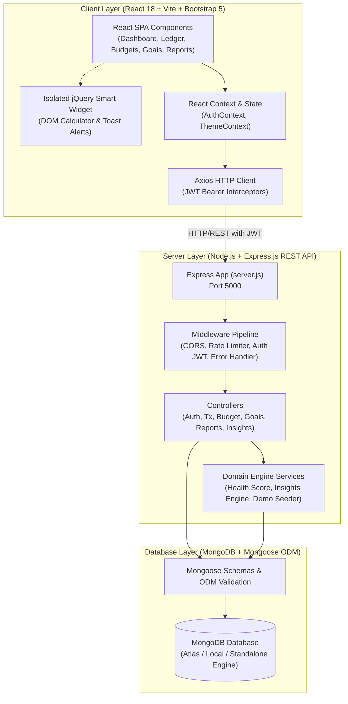
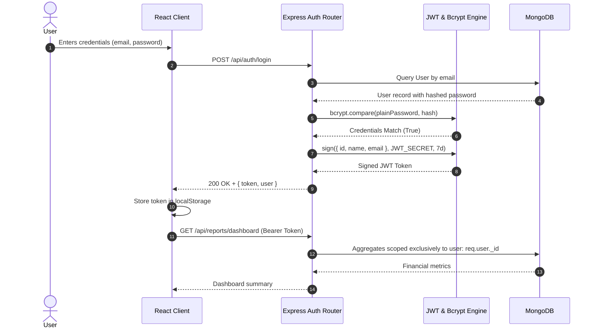

# FinTrack — System Architecture & Data Flow

## 1. System Overview

FinTrack is an enterprise-grade full-stack personal finance application architected with a decoupled Client-Server model.

## 2. Authentication & Authorization Flow

## 3. Technology Stack Justification

| Technology | Role | Justification |
| :--- | :--- | :--- |
| **HTML5** | Semantic Document Structure | Native semantic tags (`<header>`, `<nav>`, `<main>`, `<aside>`, `<footer>`) ensure SEO readability and screen reader accessibility. |
| **CSS3** | Visual Design & Animations | Custom CSS variables for emerald/navy SaaS theming, dark mode transitions, and `@keyframes` animations. |
| **Bootstrap 5** | Responsive Layout Grid | High-performance mobile-first flexbox grid, accessible modals, tooltips, and badges. |
| **JavaScript (ES6+)** | Logic & Mathematics | Strict calculation of savings rates, budget thresholds, and monetary formatting without floating-point errors. |
| **ReactJS (v18)** | Reactive User Interface | Component modularity, React Router v6 navigation, declarative Context API, and Virtual DOM rendering. |
| **jQuery (v3.7)** | Isolated UI Demonstrator | Isolated floating financial calculator and animated notification toasts demonstrating safe coexistence with React without DOM conflicts. |
| **Node.js & Express.js** | Backend API Runtime | Lightweight, non-blocking asynchronous event loop with modular router/controller/middleware separation. |
| **MongoDB & Mongoose** | Persistent Storage | Document model naturally supports hierarchical financial records, nested contribution arrays, and compound indexes. |
| **JWT & Bcrypt** | Security Engine | Stateless cryptographic authentication with salted password hashing (10 salt rounds). |
