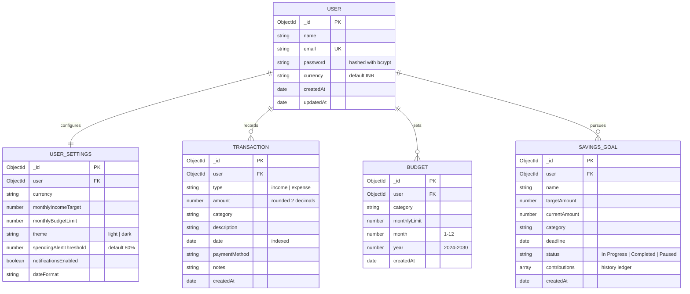

# FinTrack — Database Relationship & Schema Documentation

## 1. Entity-Relationship Diagram (ERD)

## 2. Schema Specifications & Indexes

### A. User Schema
- **Purpose**: Authenticates users and isolates ownership of financial data.
- **Key Constraints**:
  - `email`: Required, unique, trimmed, lowercase regex validated.
  - `password`: Excluded by default (`select: false`) so password hashes are never exposed in queries.
  - Salted with bcrypt (10 rounds) automatically via `pre('save')` middleware.

### B. Transaction Schema
- **Purpose**: Records cash inflows and outflows.
- **Indexes**:
  - Compound Index: `{ user: 1, date: -1 }` (optimizes date-based dashboard queries)
  - Compound Index: `{ user: 1, type: 1, date: -1 }` (optimizes income/expense filtering)
- **Validation**:
  - `amount`: Number > 0, automatically formatted to 2 decimals using `Math.round((v + Number.EPSILON) * 100) / 100`.

### C. Budget Schema
- **Purpose**: Defines spending ceilings per category per calendar month.
- **Unique Compound Index**:
  - `{ user: 1, category: 1, month: 1, year: 1 }` (enforces uniqueness so duplicate budgets cannot be created for the same category in the same month).

### D. SavingsGoal Schema
- **Purpose**: Tracks long-term target savings with deadlines and historical deposits/withdrawals.
- **Nested Contribution Schema**:
  - `amount`: Number
  - `type`: 'deposit' | 'withdrawal'
  - `date`: Date
  - `note`: String
- **Status State Machine**:
  - Automatically flips to `'Completed'` when `currentAmount >= targetAmount`.
